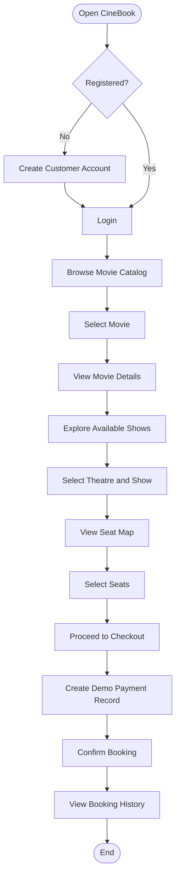
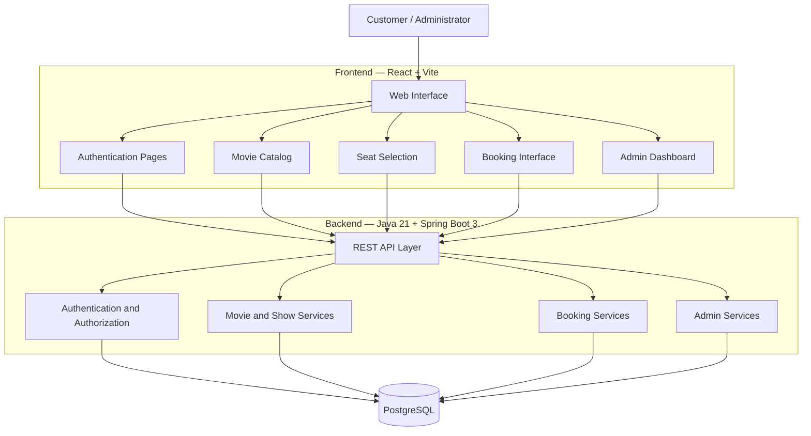
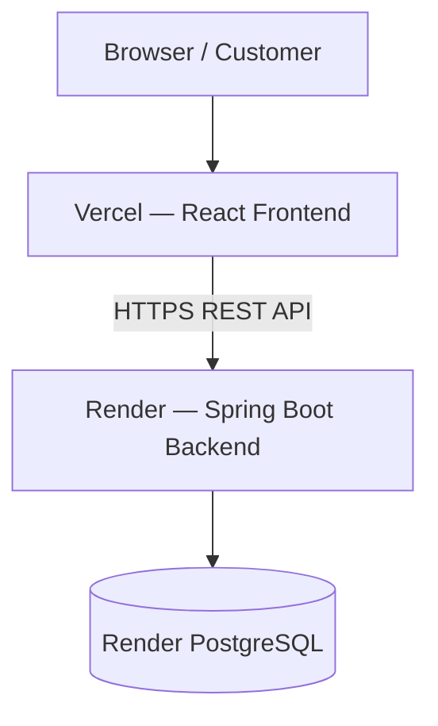

# 🎬 CineBook — Movie Ticket Booking Platform

<p align="center">
  <strong>A full-stack movie ticket booking application built with Java 21, Spring Boot, PostgreSQL, React, and Vite.</strong>
  <br/>
  Discover movies, explore showtimes, select seats, and manage bookings through a modern web interface.
</p>

<p align="center">
  
  
  
  
  
  
</p>

---

## 📖 Project Overview

**CineBook** is a full-stack movie ticket booking platform that allows customers to browse movies, explore available shows, select seats, and manage their bookings.

The application provides separate customer and administrator experiences.

Customers can register, log in, discover movies, view show details, select seats, complete the demo checkout process, and access their booking history.

Administrators can manage movie information, create shows, configure theatre screens, and review bookings through an administrative dashboard.

The backend is powered by **Java 21 and Spring Boot 3**, while the frontend uses **React and Vite**. PostgreSQL stores application data.

## 🎯 Project Objectives

- Build a complete movie ticket booking workflow.
- Implement secure customer registration and authentication.
- Develop REST APIs using Spring Boot.
- Manage movies, theatres, screens, shows, seats, and bookings.
- Create a responsive frontend using React.
- Integrate PostgreSQL for persistent storage.
- Provide administrative tools for managing cinema operations.
- Establish a foundation for real payment gateway integration.

---

## ✨ Key Features

### 👤 Customer Features

| Feature | Description |
|---|---|
| Registration | Create a customer account |
| Login | Authenticate and access the application |
| Movie Catalog | Browse available movies |
| Movie Search | Search the movie catalog |
| Movie Details | View individual movie information |
| Show Listings | Explore available movie shows |
| Seat Selection | View the seat map and select seats |
| Booking | Book selected seats for a show |
| Demo Checkout | Complete checkout using a demo payment record |
| Booking History | Review previous bookings |

### 🛠️ Admin Features

| Feature | Description |
|---|---|
| Admin Dashboard | Access administrative functionality |
| Movie Management | Create movie entries |
| Show Management | Create movie shows |
| Theatre Management | Manage theatre screens |
| Booking Overview | Review booking information |

### ⚙️ Technical Features

- Spring Boot REST API backend.
- React and Vite frontend.
- PostgreSQL database.
- JWT-based application configuration.
- Swagger API documentation.
- Docker Compose database setup.
- CORS configuration.
- Demo administrator account created on first run.
- Vercel SPA routing configuration.

---

## 🔄 Movie Booking Workflow

The customer booking process follows this sequence:



**Important:** The current checkout creates a demo payment record and confirms the booking immediately. It is not a real payment gateway integration.

---

## 🏗️ System Architecture

CineBook follows a frontend-backend architecture in which the React application communicates with Spring Boot through REST APIs.



### Architecture Components

| Component | Technology | Responsibility |
|---|---|---|
| Frontend | React | User interface |
| Build Tool | Vite | Frontend development and production builds |
| Backend | Spring Boot 3 | REST API and application logic |
| Language | Java 21 | Backend implementation |
| Database | PostgreSQL | Persistent application data |
| API Documentation | Swagger UI | API exploration and documentation |
| Containerization | Docker Compose | Local database environment |
| Frontend Hosting | Vercel | Frontend deployment |
| Backend Hosting | Render | Backend deployment |

---

## 🗂️ Project Structure

The project is organized into separate backend and frontend applications.

```text
cinebook/
│
├── backend/
│   ├── pom.xml
│   └── src/
│       └── main/
│           └── ...
│
├── frontend/
│   ├── package.json
│   ├── .env.example
│   ├── vercel.json
│   └── src/
│       └── ...
│
├── docker-compose.yml
└── README.md
```

**Note:** This is a high-level structure based on the supplied project description. The complete Java package and React component tree can be added after inspecting the repository.

---

## 🗄️ Database

CineBook uses PostgreSQL as its relational database.

The database supports the application's main functional areas:

- Customer accounts.
- Movie catalog.
- Theatre and screen management.
- Show scheduling.
- Seat selection.
- Booking records.
- Demo payment records.

The exact table names, columns, indexes, and relationships should be documented from the actual database schema and entity classes.

---

## 🔐 Authentication and Admin Access

CineBook includes customer registration and login, along with a demo administrator account created during the first application run.

### Demo administrator credentials

<badge color="warning">Development credentials only</badge>

| Field | Value |
|---|---|
| Email | `admin@cinebook.local` |
| Password | `Admin@12345` |

**Security warning:** These are demo credentials. Change them before any public deployment and never reuse them in a production environment.

### Customer account

Customers can register through the application interface.

### Backend security configuration

The deployment configuration includes:

- `APP_JWT_SECRET`
- `APP_CORS_ORIGINS`
- `APP_ADMIN_EMAIL`
- `APP_ADMIN_PASSWORD`

Use strong secrets and restrict administrator credentials to authorized operators.

---

## 🌐 API Documentation

Swagger UI is available through the backend:

```text
http://localhost:8080/swagger-ui.html
```

The API is configured under the `/api` path.

The exact API endpoints and request schemas should be taken from the generated Swagger documentation or backend controllers.

---

## 🚀 Getting Started

### Prerequisites

Install the following:

| Requirement | Version |
|---|---|
| Java | 21 |
| Maven | Compatible with the project |
| Node.js | 20 or newer |
| npm | Included with Node.js |
| Docker | Required for the supplied local database setup |
| PostgreSQL | Managed through Docker Compose locally |

### 1. Clone the repository

```bash
git clone <YOUR_GITHUB_REPOSITORY_URL>
cd cinebook
```

### 2. Start PostgreSQL using Docker Compose

From the project root:

```bash
docker compose up -d db
```

This starts the database service defined in the project's Docker Compose configuration.

### 3. Start the Spring Boot backend

Open a terminal:

```bash
cd backend
mvn spring-boot:run
```

The backend is expected to be available at:

```text
http://localhost:8080
```

### 4. Configure the frontend

Open a second terminal:

```bash
cd frontend
```

Copy the example environment file:

```bash
cp .env.example .env
```

Set the local API URL in the frontend environment configuration:

```env
VITE_API_URL=http://localhost:8080/api
```

Install dependencies:

```bash
npm install
```

### 5. Start the React application

```bash
npm run dev
```

### 6. Open CineBook

Visit:

```text
http://localhost:5173
```

### 7. Open API documentation

```text
http://localhost:8080/swagger-ui.html
```

---

## ☁️ Deployment Guide

CineBook uses a split deployment architecture:

- **Backend:** Render Web Service.
- **Database:** Render PostgreSQL.
- **Frontend:** Vercel.



### 1. Deploy PostgreSQL on Render

1. Open the Render dashboard.
2. Create a PostgreSQL database.
3. Configure the database.
4. Copy its appropriate connection details.
5. Use the JDBC connection URL for the backend.

### 2. Deploy the Spring Boot Backend

Create a new Render Web Service connected to your GitHub repository.

| Setting | Value |
|---|---|
| Root Directory | `backend` |
| Build Command | `mvn clean package -DskipTests` |
| Start Command | `java -jar target/cinebook-1.0.0.jar` |

Configure the following environment variables:

| Variable | Description |
|---|---|
| `SPRING_DATASOURCE_URL` | PostgreSQL JDBC connection URL |
| `SPRING_DATASOURCE_USERNAME` | Database username |
| `SPRING_DATASOURCE_PASSWORD` | Database password |
| `APP_JWT_SECRET` | Strong random secret, at least 32 bytes |
| `APP_CORS_ORIGINS` | Deployed Vercel frontend origin |
| `APP_ADMIN_EMAIL` | Administrator email |
| `APP_ADMIN_PASSWORD` | Strong administrator password |

Render provides the `PORT` environment variable to the web service.

Deploy the backend and note its public URL.

### 3. Deploy the React Frontend on Vercel

1. Open Vercel.
2. Import the GitHub repository.
3. Select `frontend` as the root directory.
4. Configure the build settings.

| Setting | Value |
|---|---|
| Root Directory | `frontend` |
| Build Command | `npm run build` |
| Output Directory | `dist` |

Set the frontend environment variable:

```env
VITE_API_URL=https://YOUR-RENDER-URL.onrender.com/api
```

Deploy the application.

The supplied `vercel.json` handles SPA routing.

### 4. Configure CORS

Set `APP_CORS_ORIGINS` on Render to your actual Vercel website origin.

For example:

```text
https://your-cinebook-project.vercel.app
```

Use the deployed frontend origin rather than a local development URL.

### 5. Verify the Deployment

After deployment, test:

- Customer registration.
- Customer login.
- Movie catalog loading.
- Movie search.
- Show listings.
- Seat map.
- Booking creation.
- Booking history.
- Administrator login.
- Movie and show management.

---

## 💳 Payment Integration — Important

<badge color="danger">Demo checkout only</badge>

The current implementation uses a **demo payment record** and confirms the booking immediately.

It does not provide a complete real-money payment flow.

Before accepting real payments, implement:

1. Razorpay order creation from the backend.
2. Server-side payment signature verification.
3. Payment webhook verification and reconciliation.
4. Secure booking confirmation after verified payment.
5. Payment failure and retry handling.
6. Refund and cancellation workflows.
7. Transaction-safe seat availability management.

Never treat a frontend payment-success response as proof that money has been received.

---

## ⚠️ Production Readiness

CineBook is a full-stack starter project. Additional work is necessary before operating it as a production ticket-booking service.

| Area | Recommended Improvement |
|---|---|
| Seat Reservation | Redis-based TTL seat locks |
| Booking Reliability | Idempotent booking operations |
| Lock Expiration | Background expiry worker |
| Authentication | Refresh-token rotation |
| Account Security | Email verification |
| API Protection | Rate limiting |
| Auditing | Administrative and booking audit logs |
| Testing | Unit, integration, and end-to-end tests |
| Database | Automated backups |
| Monitoring | Application and infrastructure monitoring |
| Payments | Verified gateway integration and webhook reconciliation |
| Cancellation | Defined cancellation and refund policies |
| Movie Data | Licensed metadata and poster sources |

### Seat locking considerations

Seat selection is a concurrency-sensitive operation. Multiple customers must not be allowed to confirm the same seat for the same show.

For multi-instance production deployments, use distributed seat locks with expiration and enforce booking consistency at the database level.

### Content and licensing

Use movie descriptions, posters, and other metadata only from sources that grant appropriate usage rights.

---

## 🔮 Future Enhancements

Potential future improvements include:

- Real Razorpay payment integration.
- Digital ticket generation with QR codes.
- Email and SMS booking notifications.
- Advanced movie recommendations.
- Location-based theatre discovery.
- Offers, coupons, and loyalty points.
- Movie reviews and ratings.
- Booking cancellation and refund management.
- Global seat availability updates.
- Advanced analytics for administrators.
- Mobile application for Android and iOS.

---

## 📚 Learning Outcomes

This project demonstrates practical experience with:

- Java 21 application development.
- Spring Boot REST API development.
- React component-based frontend development.
- PostgreSQL database integration.
- Frontend-backend communication.
- Customer authentication and authorization.
- Movie, theatre, show, and booking workflows.
- Seat selection interface development.
- Docker-based local database setup.
- Swagger API documentation.
- Full-stack application deployment using Render and Vercel.
- Environment-based application configuration.

---

## 👨‍💻 Developer

**Developed by Lakshya Kansal**

CineBook demonstrates a full-stack movie ticket booking architecture combining Java backend development, modern React frontend engineering, relational database management, and cloud deployment.

<p align="center">
  <strong>🎬 Discover Movies. Choose Your Seats. Book Your Experience.</strong>
  <br/>
  <em>CineBook — Your Movie Experience Starts Here.</em>
</p>
